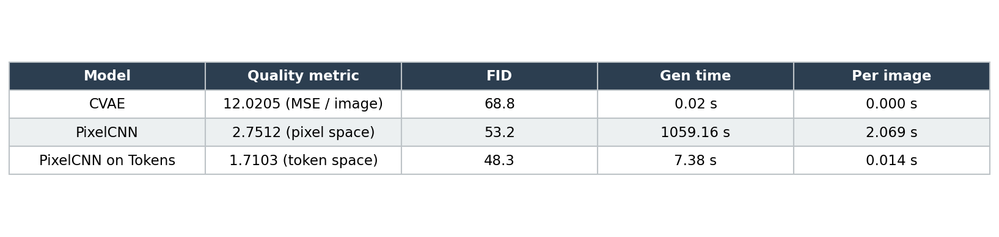
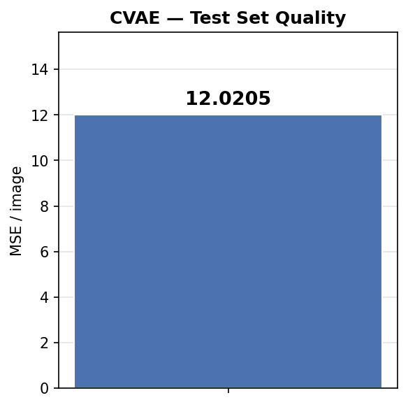
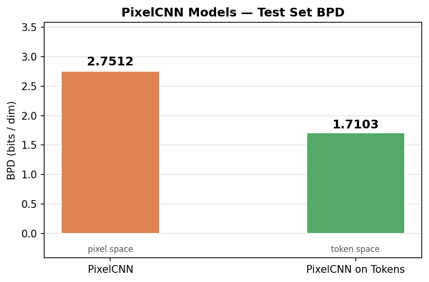
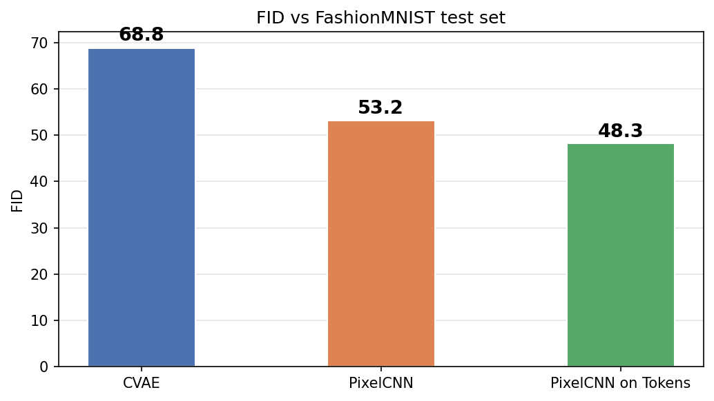
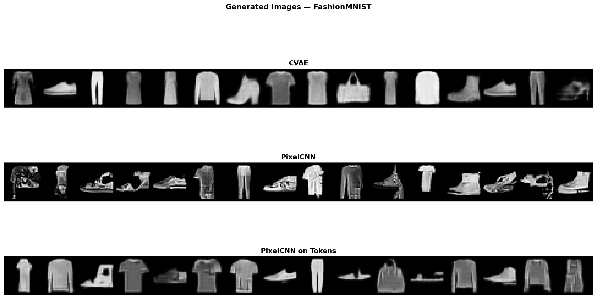

# Autoregressive Image Generation — Dokumentacja projektu

## Spis treści

1. [Przegląd projektu](#1-przegląd-projektu)
2. [Struktura projektu](#2-struktura-projektu)
3. [Dataset — FashionMNIST](#3-dataset--fashionmnist)
4. [Architektura modeli](#4-architektura-modeli)
   - 4.1 [Conditional VAE (CVAE)](#41-conditional-vae-cvae)
   - 4.2 [Vector Quantized VAE (VQ-VAE)](#42-vector-quantized-vae-vq-vae)
   - 4.3 [PixelCNN na pikselach](#43-pixelcnn-na-pikselach)
   - 4.4 [PixelCNN na tokenach](#44-pixelcnn-na-tokenach)
5. [Szczegóły trenowania](#5-szczegóły-trenowania)
6. [Analiza eksperymentów](#6-analiza-eksperymentów)
7. [Wnioski](#7-wnioski)

---

## 1. Przegląd projektu

Projekt realizuje porównanie trzech podejść do generatywnego modelowania obrazów na zbiorze **FashionMNIST** (28×28 px, skala szarości, 10 klas):

| Model | Strategia generacji |
|---|---|
| **Conditional VAE (CVAE)** | jednoprzebiegowe dekodowanie |
| **PixelCNN (piksele)** | piksel po pikselu, 784 kroków |
| **PixelCNN na tokenach** | token po tokenie, 49 kroków |


---

## 2. Struktura projektu

```
Autoregressive-Image-Generation/
│
├── docs/                          ← dokumentacja projektu
│   └── documentation.md
│
├── img_generation/                ← główna biblioteka
│   ├── datasets.py                ← ładowanie danych, transformacje, dzielenie
│   ├── utils.py                   ← EarlyStopping, wizualizacja
│   └── models/
│       ├── vae.py                 ← CVAE + VQ-VAE
│       ├── pixel_cnn.py           ← PixelCNN
│       └── load_pretrained.py     ← pobieranie pretrenowanych wag
│
├── notebooks/                     ← trening i eksperymenty
│   ├── baseline_vae.ipynb         ← trening CVAE
│   ├── vq_vae.ipynb               ← trening VQ-VAE
│   ├── pixel_cnn.ipynb            ← trening PixelCNN na pikselach
│   ├── pixel_cnn_on_tokens.ipynb  ← trening PixelCNN na tokenach
│   └── comparison_experiments.ipynb ← porównanie wszystkich modeli
│
├── pretrained_models/             ← zapisane wagi modeli
│   ├── vae/
│   │   ├── cvae.pth
│   │   └── vq_vae.pth
│   ├── pixel_cnn/
│   │   └── pixel_cnn.pth
│   └── pixel_cnn_on_tokens/
│       └── pixel_cnn.pth
│
├── experiment_results/            ← wyniki eksperymentów
│   ├── generated_samples.png
│   ├── quality_cvae.png
│   ├── quality_pixelcnn.png
│   ├── fid_comparison.png
│   ├── results_table.png
│   └── results.csv
│
├── data/                          ← pobrane datasety
└── pyproject.toml                 ← zależności projektu
```


## 3. Dataset — FashionMNIST

Wszystkie modele trenowano na tym samym zbiorze danych **FashionMNIST**:

| Właściwość | Wartość |
|---|---|
| Rozdzielczość | 28 × 28 pikseli |
| Kanały | 1 |
| Liczba klas | 10 |
| Zbiór treningowy | 54 000 próbek |
| Zbiór walidacyjny | 6 000 próbek |
| Zbiór testowy | 10 000 próbek |

**Klasy:** T-shirt, Trouser, Pullover, Dress, Coat, Sandal, Shirt, Sneaker, Bag, Ankle boot.

---

## 4. Architektura modeli

### 4.1 Conditional VAE (CVAE)

CVAE to wariacyjny autoenkoder warunkujący generację na etykiecie klasy. Architektura składa się z enkodera i dekodera opartych na konwolucjach.

#### Enkoder

```
Wejście: (B, 1, 28, 28) + etykieta klasy y
    │
    ├─ Conv2d(1→32, 4×4, stride=2, pad=1)
    │    GroupNorm + SiLU
    ├─ Conv2d(32→64, 4×4, stride=2, pad=1)
    │    GroupNorm
    ├─ Flatten → (B, 64·7·7) = (B, 3136)
    │
    ├─ Embedding(num_classes=10, embed_dim=32)
    │
    ├─ Concat([flatten, class_embed])
    │
    ├─ FC → μ ∈ R^64
    └─ FC → log σ² ∈ R^64
```

Reparametryzacja: `z = μ + σ·ε`, gdzie `ε ~ N(0, I)`.

#### Dekoder

```
Wejście: z ∈ R^64  +  etykieta klasy y
    │
    ├─ Embedding(10, 32)
    ├─ Concat([z, class_embed])
    ├─ FC(96 → 64·7·7)
    ├─ Reshape
    │
    ├─ ConvTranspose2d(64→32, 4×4, stride=2, pad=1)
    │    GroupNorm + SiLU
    ├─ ConvTranspose2d(32→1, 4×4, stride=2, pad=1)
    └─ Sigmoid
```

#### Funkcja straty

Beta-VAE:

```
L = MSE(x̂, x) + β · KLD(N(μ, σ²) || N(0, I))
```

gdzie `KLD = -0.5 · Σ(1 + log σ² - μ² - σ²)`.

---

### 4.2 Vector Quantized VAE (VQ-VAE)

VQ-VAE pełni rolę tokenizatora — koduje obraz 28×28 do siatki 7×7 dyskretnych tokenów, z których każdy jest indeksem w codebooku. Tokeny te są wejściem dla PixelCNN on Tokens.

#### Architektura

```
Enkoder (taki sam jak w CVAE, bez warunkowania klasą):
  (B, 1, 28, 28) → Conv blocks → (B, 64, 7, 7)

VQEmbedding (Quantization Layer):
  - Codebook: E ∈ R^{1024×64}
  - Dla każdego z 49 wektorów (7×7) szuka najbliższego sąsiada w codebooku:
      k = argmin_j ||z_e - e_j||²
  - Zwraca: z_q (skwantyzowany), vq_loss, encoding_indices

Dekoder:
  (B, 64, 7, 7) → ConvTranspose blocks → (B, 1, 28, 28) → Sigmoid
```

#### Funkcja straty

```
L = MSE(x̂, x)  +  ||z_q - sg(z_e)||²  +  β · ||sg(z_q) - z_e||²
```

gdzie `sg(·)` oznacza stop-gradient (straight-through estimator).

#### Generacja tokenów

```python
z_q, vq_loss, encoding_indices = vqvae.encode(x)
tokens = encoding_indices.reshape(B, 7, 7)
```

---

### 4.3 PixelCNN na pikselach

PixelCNN modeluje rozkład prawdopodobieństwa obrazu jako iloczyn warunkowych:

```
p(x) = Π_{i} p(x_i | x_1, ..., x_{i-1})
```

Implementacja oparta na architekturze z kursów UvA Deep Learning.

#### Maskowane konwolucje

Autoregresja jest wymuszana przez maskowanie wag konwolucji:

- **VerticalStackConvolution**: zależy od wszystkich pikseli powyżej (i opcjonalnie od samego środka)
- **HorizontalStackConvolution**: zależy od pikseli po lewej stronie w tym samym rzędzie

#### Architektura GatedMaskedConv

Każdy blok łączy oba stosy:

```
v_stack ──► VertConv ──► chunk(2) ──► tanh(v_val) * σ(v_gate)  ──► v_stack_out
               │
               └──► Conv1x1 ──► + ──► HorizConv ──► chunk(2) ──► tanh * σ ──► Conv1x1 ──► h_stack_out
                               ▲                                                               │
                           h_stack ────────────────────────────────────────────────────────── +
```

#### Pełna architektura PixelCNN

```
Wejście: x ∈ {0,...,255}^{1×28×28}
    │
    ├─ Normalizacja: x_norm = x/255 * 2 - 1  ∈ [-1, 1]
    │
    ├─ VerticalStackConv(1→64, mask_center=True)    ┐
    ├─ HorizontalStackConv(1→64, mask_center=True)  ┘ wejście do dual-stream
    │
    ├─ GatedMaskedConv(64, dilation=1)
    ├─ GatedMaskedConv(64, dilation=2)
    ├─ GatedMaskedConv(64, dilation=1)
    ├─ GatedMaskedConv(64, dilation=4)
    ├─ GatedMaskedConv(64, dilation=1)
    ├─ GatedMaskedConv(64, dilation=2)
    ├─ GatedMaskedConv(64, dilation=1)
    │
    ├─ ELU
    └─ Conv1x1(64 → 1·256) → logity ∈ R^{256×1×28×28}
```

Wyjście: logity dla każdego z 256 możliwych wartości piksela, w każdym pikselu.

#### Próbkowanie

Generacja przebiega sekwencyjnie — piksel po pikselu, rząd po rzędzie:

```python
for h in range(28):
    for w in range(28):
        pred = model.forward(img[:, :, :h+1, :])
        probs = softmax(pred[:, :, 0, h, w])
        img[:, 0, h, w] = multinomial(probs, 1)
```

Każdy nowy piksel jest próbkowany z rozkładu warunkowego — stąd wysoki koszt obliczeniowy: **784 kroków przejścia przez sieć** dla jednego obrazu.

#### Metryka: Bits Per Dimension

```
BPD = CrossEntropy(logity, x) · log₂(e)
```

Mierzy ile bitów potrzeba na zakodowanie jednego wymiaru.

---

### 4.4 PixelCNN na tokenach

Dwuetapowe podejście: zamiast modelować surowe piksele, modelujemy dyskretne tokeny VQ-VAE.

#### Etap 1: Tokenizacja

```
Obraz (1×28×28)  ──►  VQ-VAE encoder  ──►  siatka tokenów (7×7)
```

Każdy token to indeks w codebooku [0, 1023].

#### Etap 2: PixelCNN na tokenach

Architektura identyczna jak PixelCNN na pikselach, z dwoma kluczowymi różnicami:

| Właściwość | PixelCNN (piksele) | PixelCNN (tokeny) |
|---|---|---|
| Wejście | 1 × 28 × 28, wartości 0–255 | 7 × 7, wartości 0–1023 |
| Kodowanie wejścia | normalizacja do [-1,1] | Embedding(1025, 64) |
| Wyjście | 1·256 kanałów | 1024 kanałów |
| Kroki generacji | 784 | 49 |
| Klasy | 256 | 1024 |

#### Etap 3: Dekodowanie tokenów

```python
# Generacja tokenów
tokens = pixelcnn_tokens.sample(img_shape=(B, 1, 7, 7))

# Dekodowanie przez VQ-VAE
z_q = vqvae.vq_layer.embedding(tokens).permute(0, 3, 1, 2)
image = vqvae.normalize(vqvae.decoder(z_q))
```

---

## 5. Szczegóły trenowania

### Wspólne hiperparametry

| Parametr | Wartość |
|---|---|
| Dataset | FashionMNIST |
| Epoki | **70** |
| Seed | 42 |
| Optymalizator | Adam |
| Scheduler | ExponentialLR |

### CVAE

| Parametr | Wartość |
|---|---|
| Batch size | 128 |
| `latent_dim` | 64 |
| `hidden_dim_channels` | 32 |
| `class_embed_dim` | 32 |
| `beta` | 0.5 |
| Early stopping patience | 10 |
| Czas trenowania | ~9 minut (MPS) |

### VQ-VAE

| Parametr | Wartość |
|---|---|
| Batch size | 128 |
| `hidden_dim` | 32 |
| `num_embeddings` | 1024 |
| `commitment_cost` | 0.25 |
| Czas trenowania | ~15 minut (MPS) |

### PixelCNN (piksele)

| Parametr | Wartość |
|---|---|
| Batch size | 128 |
| `c_in` | 1 |
| `c_hidden` | 64 |
| `num_classes` | 256 |
| `on_tokens` | False |
| Framework | PyTorch Lightning |
| Czas trenowania | **~204 minut** (MPS) |

### PixelCNN (tokeny)

| Parametr | Wartość |
|---|---|
| Batch size | 128 |
| `c_in` | 1 |
| `c_hidden` | 64 |
| `num_classes` | 1024 |
| `on_tokens` | True |
| Framework | PyTorch Lightning |
| Czas trenowania | **~17 minut** (MPS) |

### Uwaga o zasobach obliczeniowych

Wszystkie modele trenowane były przez **70 epok**. W literaturze i dostępnych implementacjach PixelCNN spotykane jest trenowanie przez **150 epok**. Dłuższy trening mógłby poprawić metryki BPD i FID — szczególnie dla PixelCNN na pikselach, który potrzebuje dużo czasu by dobrze wymodelować 784-wymiarowe zależności. Ograniczone zasoby obliczeniowe uniemożliwiły przeprowadzenie pełnego trenowania.

---

## 6. Analiza eksperymentów

### 6.1 Wyniki ilościowe

| Model | Metryka jakości | FID ↓ | Czas generacji (512 img) | Czas / obraz |
|---|---|---|---|---|
| **CVAE** | MSE = 12.0205 | 68.8 | 0.02 s | 0.000 s |
| **PixelCNN** | BPD = 2.7512 (pixel space) | 53.2 | 1059.16 s | 2.069 s |
| **PixelCNN on Tokens** | BPD = 1.7103 (token space) | **48.3** | 7.38 s | 0.014 s |



### 6.2 Metryki jakości na zbiorze testowym

#### CVAE — MSE rekonstrukcji



Wartość MSE = **12.02** wskazuje na pewne rozmycie rekonstrukcji. Model jest warunkowany na etykietę klasy, co pozwala na ukierunkowaną generację.

#### PixelCNN — BPD



- **PixelCNN na pikselach**: BPD = **2.7512** — model uczy się rozkładu nad 784 pikselami; każdy piksel modelowany jest jako jedna z 256 klas.
- **PixelCNN na tokenach**: BPD = **1.7103** — niższe BPD wynika częściowo z faktu, że modelujemy tylko 49 tokenów (7×7), a nie 784 piksele. Modele operują w różnych przestrzeniach i ich BPD nie są bezpośrednio porównywalne.

### 6.3 FID — porównanie modeli



FID (Fréchet Inception Distance) mierzy odległość między statystykami cech Inception-v3 obliczonych dla prawdziwych i wygenerowanych obrazów. Mierzona na n = 512 obrazach.

- **CVAE**: FID = **68.8** — najgorszy wynik, obrazy są rozmyte i mniej realistyczne.
- **PixelCNN (piksele)**: FID = **53.2** — pomimo bardzo wolnej generacji, jakość wizualna jest lepsza.
- **PixelCNN na tokenach**: FID = **48.3** — najlepszy wynik, generuje najbardziej realistyczne obrazy przy jednocześnie akceptowalnym czasie generacji.

### 6.4 Wygenerowane próbki



- **CVAE**: obrazy są wyraźnie rozpoznawalne jako elementy garderoby, ale są nieco rozmyte.
- **PixelCNN (piksele)**: obrazy zawierają wyraźną strukturę tekstury, ale bywa, że globalna spójność jest słabsza.
- **PixelCNN na tokenach**: obrazy zachowują ostrość przy jednoczesnej globalnej spójności.

### 6.5 Czas generacji

| Model | Czas / obraz |
|---|---|
| CVAE | ~0.000 s |
| PixelCNN (tokeny) | ~0.014 s |
| PixelCNN (piksele) | ~2.069 s |

PixelCNN na pikselach jest **140× wolniejszy** niż PixelCNN na tokenach. Wynika to wprost z rozmiaru przestrzeni: 28×28 = 784 kroków vs 7×7 = 49 kroków. Każdy krok wymaga pełnego przejścia przez sieć dla aktualnie wygenerowanego fragmentu obrazu.

### 6.6 Omówienie wyników

**CVAE** jest najszybszą metodą, ale osiąga najgorszy FID. Wygenerowane obrazy są często rozmyte. Warunkowanie na klasę pozwala jednak na ukierunkowaną generację konkretnych kategorii.

**PixelCNN na pikselach** osiąga dobry FID przy stosunkowo krótkim trenowaniu. Wadą jest ekstremalna wolność generacji — 2 sekundy na obraz.

**PixelCNN na tokenach** to najlepszy model wśród testowanych. Dobrze rekonstruuje obrazy przy jednocześnie szybkiej generacji.

---

## 7. Wnioski

### Co sprawdziło się dobrze

- **PixelCNN na tokenach** wyraźnie dominuje w kompromisie jakość/szybkość — jest to architektura rekomendowana dla podobnych zastosowań.
- VQ-VAE jako tokenizer generuje reprezentacje na tyle kompresywne, że PixelCNN pracuje na 16× mniejszej siatce bez istotnej utraty jakości.
- Zastosowanie PyTorch Lightning dla PixelCNN upraszcza trening i zapewnia automatyczny checkpointing.

### Ograniczenia i możliwe ulepszenia

1. **Długość trenowania**: Wszystkie modele trenowano przez 70 epok. Referencyjne implementacje PixelCNN sugerują 150 epok — przy dostępie do GPU możliwe byłoby osiągnięcie wyraźnie niższego BPD i FID.

2. **Brak augmentacji**: Modele trenowano bez augmentacji danych, co mogłoby poprawić generalizację CVAE.

### Podsumowanie metryk

```
                    CVAE      PixelCNN    PixelCNN+VQ-VAE
────────────────────────────────────────────────────────
FID ↓              68.8        53.2            48.3
Czas/obraz        0.000s      2.069s          0.014s
```
